 

<a href="mailto:hussain04habib@gmail.com">Email</a> &nbsp;/&nbsp;
<a href="https://linkedin.com/in/hussain-habib">LinkedIn</a> &nbsp;/&nbsp;
<a href="https://twitter.com/Hussain2004004">X</a> &nbsp;/&nbsp;
<a href="https://leetcode.com/Hussain_04">LeetCode</a> &nbsp;/&nbsp;
<a href="https://hussain04.vercel.app/">Portfolio</a> &nbsp;/&nbsp;
<a href="https://hussain04.vercel.app/hussain-habib-cv.pdf">CV</a>

  

 

### Selected work

<table>
<tr>
<td></td>
<td></td>
</tr>
<tr>
<td></td>
<td></td>
</tr>
</table>

### Stack

